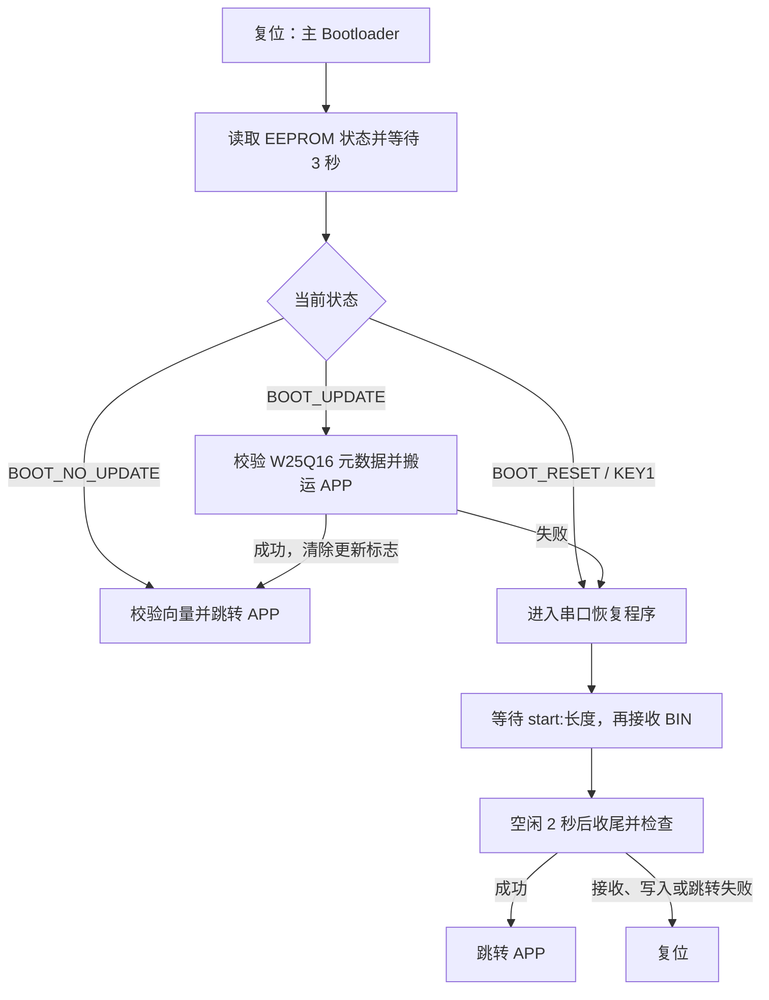

# STM32F407 Bootloader

基于 STM32F407VET6、STM32 HAL 和 Keil MDK 的三工程启动与升级示例：主 Bootloader 根据 EEPROM 状态启动 APP、从 W25Q16 搬运固件，或进入独立的串口恢复程序；LED APP 通过串口 `cmd` 触发 CAN 更新命令，并在接收结束后打印累计字节数。配套 F103 当前使用内部 Flash 中已有的 4480 字节 BIN，收到 `hyf` 后分帧发送；串口接收和内部 Flash 写入功能仍保留，当前未接入启动流程。

初始三工程源码基线：[430dadb](https://github.com/Mangta517/bootloader/commit/430dadbbfdbfa0a3d6f865c4147dae49b106cc4c)（2026-10-27）。后续改动、验证结果和剩余问题见[更新记录](#更新记录)。

## 工程组成

| 目录 | 作用 | Keil 工程 |
| --- | --- | --- |
| [`stm32f407vet6`](stm32f407vet6) | 主 Bootloader：读取 EEPROM 状态、等待 KEY1 请求、执行 W25Q16 更新并选择跳转目标 | [`stm32f407vet6.uvprojx`](stm32f407vet6/MDK-ARM/stm32f407vet6.uvprojx) |
| [`stm32f407vet6reset`](stm32f407vet6reset) | 独立恢复程序：USART1 接收 BIN、写入 APP 区并跳转 | [`stm32f407vet6reset.uvprojx`](stm32f407vet6reset/MDK-ARM/stm32f407vet6reset.uvprojx) |
| [`stm32f407vet6led`](stm32f407vet6led) | 示例 APP：空闲闪灯；串口 `cmd` 触发一次 `hyf`，随后累计 CAN 接收长度 | [`stm32f407vet6led.uvprojx`](stm32f407vet6led/MDK-ARM/stm32f407vet6led.uvprojx) |
| [`STM32F103CAN`](STM32F103CAN) | 配套发送端：收到 `hyf` 后，将 Flash 中已有的 BIN 以标准 ID 1 分帧发送 | [`STM32F103CAN.uvprojx`](STM32F103CAN/MDK-ARM/STM32F103CAN.uvprojx) |

四个目录保留各自的 `Core`、`Drivers`、CubeMX `.ioc` 和 Keil 配置；主引导、恢复和配套 CAN 工程还包含 `application`、`interface` 和主机测试。仓库不纳入旁边的 CMake 工程、历史备份、动画实验、编译产物和本机调试设置。厂商依赖保留原有许可证文件。

## Flash 分区与启动流程

| 程序 | 起始地址 | 结束地址（含） | 容量 | 向量表偏移 |
| --- | --- | --- | --- | --- |
| 主 Bootloader | `0x08000000` | `0x08003FFF` | 16 KiB | `0x0000` |
| 串口恢复程序 | `0x08004000` | `0x08007FFF` | 16 KiB | `0x4000` |
| APP | `0x08008000` | `0x0807FFFF` | 480 KiB（491520 字节） | `0x8000` |

链接配置中的上界为 `0x08080000`，不属于可写 APP 范围。扇区 0、1 分别保留给主引导和恢复程序，APP 从扇区 2 开始。



流程入口为 [`Core/Src/main.c`](stm32f407vet6/Core/Src/main.c) 和 [`application/app_bootloader.c`](stm32f407vet6/application/app_bootloader.c)。KEY1 通过中断设置本次启动的恢复请求；主引导只执行一次检查、更新和跳转，跳转失败后打印错误并停留在空主循环，没有自动进入恢复程序的后续状态机。

## 硬件连接

三个 F407 工程均采用 HSE 8 MHz、系统时钟 168 MHz；F103 使用 HSE 8 MHz、系统时钟 72 MHz。

| 功能 | 引脚 / 参数 |
| --- | --- |
| USART1 | PA9=TX、PA10=RX；115200、8N1、无流控 |
| W25Q16，2 MiB SPI Flash | PB3=SCK、PB4=MISO、PB5=MOSI、PB0=低有效 CS |
| 24C02，256 字节 EEPROM | PB6=I2C1 SCL、PB7=SDA；7 位地址 `0x50`；需要外部上拉，写入时 WP 为低 |
| KEY1 | PE0 / EXTI0，触发主引导的恢复请求 |
| LED0 / LED1 | PE5 / PE6，低电平点亮 |

USB 转串口使用 3.3 V TTL 电平，TX 接板卡 RX，RX 接板卡 TX，并共地。恢复程序当前由 `main.c` 将 PE6 拉低常亮；LED APP 在空闲状态交替点亮 PE5、PE6。主工程不包含 CAN 通信功能。

## EEPROM 状态与 W25Q16 更新

主引导使用 EEPROM `0x10–0x12`：

| 地址 / 值 | 含义 |
| --- | --- |
| `0x10 = 0x01` | `BOOT_UPDATE`，从 W25Q16 更新 APP |
| `0x10 = 0x02` | `BOOT_NO_UPDATE`，直接尝试启动 APP |
| `0x10 = 0x03` | `BOOT_RESET`，进入恢复程序 |
| `0x11 = 0x5A`、`0x12 = 0x6B` | 有效密钥 `0x5A6B` |

密钥无效时写入 `01 5A 6B`，但本次启动保留原来的 RAM 状态，默认尝试启动 APP；新写入的更新标记会在下次启动时读取。准备普通启动时应写入 `02 5A 6B`；准备外部 Flash 更新时，应先完成固件和元数据写入，再设置 `01 5A 6B`。

W25Q16 `0x000000–0x000007` 存放两项 32 位小端元数据，定义见 [`application/app_bootloader.h`](stm32f407vet6/application/app_bootloader.h)：

| W25Q16 地址 | 内容 | 当前检查条件 |
| --- | --- | --- |
| `0x000000–0x000003` | APP 在 W25Q16 内的起始地址 | `8 <= 起点 < 0x1000` |
| `0x000004–0x000007` | BIN 字节长度 | `0x800 < 长度 <= 0x78000`，整段不能超出 W25Q16 容量 |
| 元数据指定的起点 | 链接到 `0x08008000` 的 APP BIN | 前 8 字节为初始 MSP 和复位入口 |

例如起点为 `0x100`、长度为 4480 字节时，元数据为 `00 01 00 00 80 11 00 00`，BIN 从 W25Q16 地址 `0x100` 开始写入。

更新前检查元数据、初始栈范围和复位入口范围，按长度一次性擦除 APP 覆盖的内部 Flash 扇区，再用 512 字节缓冲搬运并按半字写入；奇数长度尾部补 `0xFF`。SPI 读取失败、BUSY 超时或 Flash 操作失败时保留更新标志，并在本次启动转入恢复程序。全部写入成功后将 EEPROM 状态改为 `BOOT_NO_UPDATE`，再尝试跳转 APP。

当前主引导没有接收 W25Q16 固件的串口命令，仓库也未提供外部 Flash 灌装工具；需通过自己的应用或编程工具准备 W25Q16 内容和 EEPROM 标志。两条升级路径的长度条件不同：W25Q16 搬运要求大于 2048 字节，串口恢复接收长度允许 `1–491520` 字节，但最终启动还取决于有效的 APP 向量。

## 串口恢复升级

1. 先将恢复程序部署到 `0x08004000`，再由主引导通过 KEY1 或 EEPROM 的 `BOOT_RESET` 状态进入。
2. 看到等待 `start:len` 的提示后，以文本发送 `start:实际BIN字节数`。命令通过串口空闲识别结束，可附加 CR/LF；命令与 BIN 分开发送。
3. 等待 `Flash erased; send data`，再按原始二进制文件方式发送链接到 `0x08008000` 的 APP BIN。
4. 接收停止且数据处理完成后，等待 2 秒无新数据；新数据会重新触发空闲确认和计时，无需按键收尾。
5. DMA 尾部数据、奇数末字节、接收长度及 UART/DMA/Flash 状态检查通过后，打印 `ok,len:实际字节数` 并跳转 APP；错误路径打印信息并复位。

该过程直接覆盖 APP 区，不更新 W25Q16 内容，也不自动清除主引导 EEPROM 中持久保存的升级 / 恢复状态。需要复位后直接启动 APP 时，应另行将 EEPROM 状态改为 `BOOT_NO_UPDATE`。

接收与收尾说明见 [`SERIAL_UPGRADE.md`](stm32f407vet6reset/SERIAL_UPGRADE.md)，实现位于 [`app_reset.c`](stm32f407vet6reset/application/app_reset.c) 和 [`int_bootloader.c`](stm32f407vet6reset/interface/int_bootloader.c)。

## F103 串口接收与 CAN 配套

F103C8 的程序区域为 `0x08000000～0x08007FFF`，串口接收数据区为 `0x08008000～0x0800FFFF`，最大 BIN 为 32768 字节。
当前 F103 启动直接设置已有 BIN 的长度为 4480 字节、状态为 `APP_FLASH_DONE`，随后调用 `app_update_init()` 等待 CAN 命令；复位不擦除 BIN 数据区，也不等待重新通过串口接收。长度由 `APP_UPDATE_STORED_SIZE_BYTES` 定义，不自动探测 Flash 内容，不会跟随 F407 APP 构建产物变化。

需要装载新 BIN 时，先按 F103 操作说明恢复 `App_bootloader_init()` 和独立接收循环：发送 `start:十进制长度`，等待擦除完成后发送 BIN；串口接收、Flash 写入和空闲 2 秒收尾成功后，再初始化 CAN 更新判断。更换已存 BIN 后须同步固定长度宏。

CAN 双方均为 200 kbit/s：F407 PB8/RX、PB9/TX；F103 PA11/RX、PA12/TX，均经 CAN 收发器接入总线、共地，并在总线两端各接一个 120 Ω 终端。

F407 在 USART1 收到 `cmd` 后发送一次标准 ID 0、DLC 3 的 `hyf`，随后进入接收状态。F103 严格校验命令和 Flash 状态后，以标准 ID 1 发送有效 BIN，单帧最多 8 字节，尾帧只发送剩余字节；每帧发送成功后等待 10 ms，发送完成后停留 DONE，失败或超时则进入 ERROR 并停止。

F407 只累计标准 ID 1、DLC 为 1～8 的数据帧，接收期间不逐帧打印。连续 1 秒无有效数据后输出一次 `CAN receive done,len:实际接收字节数`，再回到空闲；完全没有收到数据也会报告 0。开始下一轮前复位 F103，再向空闲的 F407 发送 `cmd`。

当前 CAN 路径只做接收长度统计，不进行数据内容校验、W25Q16 保存或 EEPROM 更新。CAN 接收中断和 1 KiB 数据缓冲尚未实现，相关容量与连续擦写时序讨论不属于当前代码功能。

- [F103 串口操作、Flash 分区与验证](STM32F103CAN/FLASH_RECEIVE.md)
- [F103 CAN 状态机与功能接口](STM32F103CAN/CAN_README.md)
- [F407 CAN 命令与接线](stm32f407vet6led/CAN_RECEIVE.md)

## 构建与部署

使用 Keil µVision 5、ARM Compiler 5.06 update 5（build 528）及 STM32F4xx 设备支持包，分别打开对应的 `.uvprojx` 并全量重建。工程内的源文件和头文件目录使用相对路径，保留目录结构即可解析。

LED APP 的 After Build 命令目前保留本机 `D:\32 51\51\ARM\ARMCC\bin\fromelf.exe` 绝对路径；换机器时应在 Keil 的 Options for Target → User 中调整该路径，或关闭该命令后手动生成 BIN。在 LED 工程的 `MDK-ARM` 目录执行：

```powershell
& '你的Keil安装目录\ARM\ARMCC\bin\fromelf.exe' --bin --output='.\stm32f407vet6led\stm32f407vet6led.bin' '.\stm32f407vet6led\stm32f407vet6led.axf'
```

使用 SWD 调试器将三个 F407 程序分别部署到 F407，将配套 F103 程序部署到 F103：

| 工程 | 重建输出位置（相对仓库根目录） | BIN 写入地址 |
| --- | --- | --- |
| 主引导 | `stm32f407vet6/MDK-ARM/stm32f407vet6/` | `0x08000000` |
| 恢复程序 | `stm32f407vet6reset/MDK-ARM/stm32f407vet6reset/` | `0x08004000` |
| LED APP | `stm32f407vet6led/MDK-ARM/stm32f407vet6led/` | `0x08008000` |
| F103 CAN 程序（独立目标板） | `STM32F103CAN/MDK-ARM/STM32F103CAN/` | `0x08000000` |

HEX / AXF 自带地址信息，裸 BIN 需要指定上表地址。连续部署时使用目标扇区擦除，避免后一次整片擦除删除先前写入的主引导或恢复程序。仓库不包含预编译 BIN / HEX，使用本次构建产物。

自定义 APP 也必须链接到 `0x08008000`、容量设为 `0x78000`，并在中断启用前定位向量表。当前交接会关闭全局中断，恢复程序和 LED APP 均在入口设置自身 VTOR 并在 HAL 初始化前重新开启中断。

## 验证

在 Windows 安装 Python 3 和 MinGW-w64 GCC，将 `python`、`gcc` 加入 PATH。在仓库根目录运行：

```powershell
python -B .\stm32f407vet6\tools\test_eeprom.py
python -B .\stm32f407vet6\tools\test_w25q16.py
python -B .\stm32f407vet6\tools\test_bootloader_jump.py
python -B .\stm32f407vet6reset\tools\test_eeprom.py
python -B .\stm32f407vet6reset\tools\test_w25q16.py
python -B .\stm32f407vet6reset\tools\test_uart_ring.py
python -B .\stm32f407vet6led\tools\test_can_receive.py
python -B .\STM32F103CAN\tools\test_uart_receive.py
python -B .\STM32F103CAN\tools\test_app_flash.py
python -B .\STM32F103CAN\tools\test_app_update.py
```

这些测试以模拟 HAL 和内存运行实际 C 代码；部分用例使用 Windows 内存映射接口，不能假设在 Linux / macOS 上直接可运行。

2026-10-27 对源码基线 `430dadb` 的验证：

| 检查 | 实际结果 |
| --- | --- |
| 主工程 EEPROM / W25Q16 / 跳转与搬运回归 | 3 项全部通过；覆盖页边界、SPI 失败 / BUSY 超时、元数据与向量、完整 APP 搬运、扇区边界、奇数尾部、更新标志和 HAL 失败 |
| 恢复工程 EEPROM / W25Q16 / UART-DMA 回归 | 3 项全部通过；覆盖环形缓冲、溢出、UART 错误、2 秒收尾、续传计时、tick 回绕、跨扇区和容量边界 |
| 三工程 Keil 全量重建 | 均为 0 Error(s)、0 Warning(s) |
| 纳管范围、Keil 文件依赖与实际链接分区 | 通过，三个分区与上表一致 |

本次 MAP 中的 ROM 占用（Code + RO Data + RW Data）：

| 工程 | ROM | 分区余量 |
| --- | --- | --- |
| 主引导 | 14344 B | 2040 B |
| 恢复程序 | 12624 B | 3760 B |
| LED APP | 4480 B | 487040 B |

本次未烧录或执行实板验证。主机回归和链接成功不代表真实串口 / SPI / I²C 时序、掉电恢复或连续升级已经验证。

## 当前限制

- 两条升级路径均未提供 CRC、镜像签名或完整写后读回比对，长度和向量检查不能证明固件内容完整、一致或可信。
- EEPROM 接口不返回通信结果；升级标志没有掉电事务保护，读取异常、写入失败和中途掉电的板级恢复行为仍待验证。
- 主引导跳转失败后停留空主循环；持久 `BOOT_RESET` 状态不会由恢复程序自动清除，后续复位仍会进入恢复流程。
- W25Q16 更新和串口恢复直接擦写同一 APP 区，没有 A/B APP 回滚；恢复区需要事先正确部署。
- LED APP 的 BIN 生成命令包含本机工具路径，换机需要调整；实际硬件接线与本页一致性仍需自行核对。
- CAN 接收目前只累计字节数，长度一致不能证明内容、顺序或重复帧正确；没有结束帧，连续 1 秒无有效数据会结束本轮。尚未实现 CAN 接收中断、1 KiB 数据缓冲、W25Q16 保存和 EEPROM 更新。
- F103 当前使用固定 4480 字节的已有 BIN 联调入口，新板或已擦除数据区不能直接套用；需先装载有效 BIN 并同步长度。F103 发送完成或失败后，开始下一轮前需要复位。

## 更新记录

### 2026-11-01 · [957ea1f](https://github.com/Mangta517/bootloader/commit/957ea1fbb9615138a5fd2659dd68efa763e85647) · F103 BIN 分帧发送与 F407 接收长度测试

- **问题**：原发布版本的 F103 发送函数为空、启动入口未启用；F407 周期发送 `hyf`，无法按串口命令开始一轮完整接收长度测试。逐帧阻塞串口打印也会影响接收节拍。
- **改动**：F103 使用 Flash 中已有的 4480 字节 BIN 启动联调，严格校验命令后以 ID 1 分帧发送，每帧后等待 10 ms；CAN 发送检查 TXOK，失败或 100 ms 超时后停止。F407 改为 USART1 IDLE 中断识别 `cmd`、单次发送 `hyf`、主循环累计有效接收字节，空闲 1 秒后打印长度并返回空闲。同步 HAL 依赖、CubeMX/Keil 配置、主机测试、配套操作说明和历史逐帧联调统计 JSON。
- **优化作用**：接收期间取消逐帧阻塞打印，减少打印对接收测试的影响；明确区分发送完成、接收字节数以及实际固件保存。每轮 F407 统计在发送命令前清零，便于重复测试。
- **验证结果**：针对本功能提交的代码，10 套主机回归全部通过；主 Bootloader、串口恢复、F407 APP、F103 四个 Keil 工程全量重建均为 0 错误、0 警告。当前长度统计版本的用户回传 F407 实板串口日志显示 `CAN receive done,len:4480`，与联调 BIN 长度一致；这是长度反馈，未做内容校验。历史 JSON 的逐字节匹配结果属于此前逐帧打印版本。本次 Git 发布操作未烧录或执行新的实板测试。
- **剩余问题**：当前 F407 没有接收中断、1 KiB 数据缓冲、CAN 固件内容校验、W25Q16 保存和 EEPROM 标志提交。F103 固定长度须与已有 BIN 一致，开始下一轮前需要复位。F407 命令发送沿用原邮箱等待和返回结果处理；原有主引导、恢复程序及掉电限制保留。

### 2026-10-31 · [68a7f9d](https://github.com/Mangta517/bootloader/commit/68a7f9d76124c630d224de5bbaf29fb7fd494a31) · F103 串口接收与 F407 CAN 配套

- **问题**：F103 串口接收/Flash 和 F407 CAN 命令工程仅保存在本地，F103 被原发布白名单忽略，缺少配套版本。
- **改动**：纳入 F103 源码、HAL/CMSIS、CubeMX/Keil 配置、串口/CAN 接口、三个主机测试和操作说明；同步 F407 LED APP 的 CAN/USART 配置、`hyf` 命令及回归；调整忽略规则并保留厂商许可证。源码保留当前本地状态，未擅自取消 F103 主函数中的注释。
- **优化作用**：将 `start:长度`、Flash 分区、原串口反馈和 F407/F103 CAN 命令保存在同一仓库版本；编译结果、备份、生成图片和调试缓存不纳入源码。
- **验证结果**：四工程 Keil 全量重建均为 0 错误、0 警告。主引导三套、恢复程序三套、F407 CAN 一套及 F103 的 DMA、接收/Flash 联合两套回归通过，共 9 套；F103 `test_app_update.py` 启动顺序回归失败，原因是 `main.c` 中接收循环和更新初始化被注释。本条文档提交引用上述功能提交的检查结果，没有额外重复构建。
- **剩余问题**：当前 F103 接收启动入口未启用；`app_update_send()` 仍为空，尚不能经 CAN 发送 BIN；F407 邮箱等待及未检查发送结果沿用当前实现。未烧录或进行实板验证；原有其余限制保留。


### 2026-10-27 · [430dadb](https://github.com/Mangta517/bootloader/commit/430dadbbfdbfa0a3d6f865c4147dae49b106cc4c) · 三工程首次纳管

- **问题**：主引导、串口恢复和示例 APP 分散在本地，缺少能够一起构建、联调和追溯的源码基线及使用说明。
- **改动**：导入上述三个工程的现有源码、CubeMX / Keil 配置、厂商依赖和六项主机测试；根目录 `.gitignore` 限定发布范围并排除备份、输出及调试缓存。本次没有改动固件业务逻辑；本页作为配套文档提交记录该基线。
- **优化作用**：统一保存 `0x08000000` 主引导、`0x08004000` 恢复程序、`0x08008000` APP 的配套版本；说明 EEPROM 标志、W25Q16 元数据和串口操作，减少路径、地址和升级方式混用。不宣称本次带来了运行速度、可靠性或功耗的实测提升。
- **验证结果**：六项现有主机回归全部通过；三个 Keil 工程全量重建均为 0 错误、0 警告；源文件依赖、实际链接分区与发布范围检查通过。README 文档提交复用本基线的固件测试结果，不重复列为功能版本。
- **剩余问题**：未烧录或进行实板验证；CRC / 签名、EEPROM 通信反馈、掉电事务、跳转失败后的处理及本机 fromelf 路径限制见[当前限制](#当前限制)。

## 后续记录规则

1. 每次提交说明必须写清“改动：涉及模块 / 文件及行为变化”和“优化：解决的问题或带来的作用”，不能只写“更新”或“优化”。
2. 功能或修复提交完成后，在本页补入确定的提交号链接、日期、问题、改动及作用、验证结果和剩余问题，并随推送同步提交文档。
3. 问题写具体触发现象，改动写主要文件与修改后的行为；没有实测的数据不写成已经验证的收益。
4. 验证结果写实际执行的检查、对应代码版本和结果；没有执行写“未运行”，没有历史证据写“未记录”。主机测试、Keil 构建、烧录和实板验证分别说明。
5. 保留旧版本交付时尚未解决的问题，用后续修复提交链接追溯；纯文档提交不重复列为功能版本，也不为填写其自身提交号反复提交。
